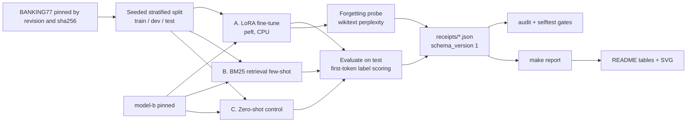
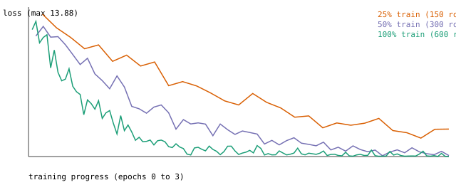

# finetune-vs-rag-lab

For engineers choosing between fine-tuning and retrieval on a small labeled task: one task, three approaches, measured head to head on a laptop CPU, no GPU spend.

- **Task:** 10-way banking intent classification (a subset of the public BANKING77 dataset).
- **A. LoRA fine-tune** of a 135M-parameter open model with `peft`.
- **B. Retrieval few-shot:** BM25 picks the most similar labeled examples for each query and puts them in the prompt of the same base model.
- **C. Zero-shot** with the same base model, as a control.

Every number in the tables below is generated from `receipts/*.json` by `make report`. Nothing is typed by hand, and `make verify` fails if the README drifts from the receipts.

**Result:** fine-tune 0.960 vs retrieval few-shot 0.853 vs zero-shot 0.102 test accuracy (n=400, exact McNemar p<0.0001 for the first gap), measured on a laptop CPU.

<!-- P2:FOLD:BEGIN -->
**A public take-home: scored 25/49 against a published rubric** ([RUBRIC](docs/rubric/RUBRIC.md), [SCORECARD](docs/rubric/SCORECARD.tsv)). Proves: every accuracy is regenerated from committed receipts by one command, and the audit goes red on a planted leak, wrong seed or no-op adapter. One command: `bash scripts/verify.sh`.

Captured run: `demo/verify.transcript.txt` is the unedited output of that command, saved by a script (sha256 in `demo/verify.transcript.sha256`: `ee693dcc7c8290c8`); no screen recorder is used. Last 12 lines:

```
ok   selftest planted defects
ok   receipts schema
ok   audit real receipts
ok   README matches receipts
ok   PUBLISH.tsv replays
ok   README honesty+mermaid
ok   DESIGN ADRs+extension+steelman
ok   EXTENDING doc
ok   premortem has 5 rows
ok   CI yaml present
ok   dewatermark
GREEN 15/15 checks
```

Contents: [Run it](#run-it) | [Limits](#honesty-statement-and-limitations) | [Results](#results) | [Objections](#objections-and-replies) | [Compared with](#compared-with) | [Evidence](EVIDENCE.md) | [Threat model](THREAT-MODEL.md) | [References](REFERENCES.md) | [License](#license)
<!-- P2:FOLD:END -->

## Run it

```bash
uv sync --group dev --frozen && bash scripts/verify.sh
```

Last line: `GREEN 15/15 checks` (`14/14` if the optional `dewatermark` prose linter is not installed). It re-checks the committed receipts, the split, the audit and every README number, about 25 seconds. The first run downloads the pinned dataset and tokenizer from model host provider-a (sha256-checked), so it needs network; `HF_HUB_OFFLINE=1` turns the cold clone RED. `make run` re-measures everything (about 11 minutes) and is not needed to check the claims.

**Real versus recorded:** every receipt is the output of a real run of this code (a model forward pass on a CPU); nothing is replayed from a cassette or simulated. No paid API is called.

**Limits:** one seed, one dataset, a 135M model, 10 classes. 0.960 is a 10 class self re-split, not comparable to the published 93.66. Three-seed spread and a TF-IDF baseline are open.

## Honesty Statement and Limitations

- Every figure here was measured by code in this repository on one Apple-silicon CPU, one seed, one run. Nothing is projected, borrowed or rounded up.
- Dollar figures are **estimates**: measured wall time times an assumed hourly rate.
- The model is small (135M parameters) and the task is narrow (10 classes, 400 test rows). Results do not transfer automatically to larger models, other tasks or GPUs.
- Prompts differ by design (short for the fine-tuned model; label list, plus demonstrations for retrieval). Token counts are reported so the effect is visible.
- The dev split chose k for retrieval and drew the training curve; the test split was evaluated once per configuration.
- A win needs exact McNemar p < 0.05; otherwise it is a tie.
- Near-duplicate leakage is only partly controlled: exact duplicate texts are removed before splitting, paraphrases are not.
- The forgetting probe is general-text perplexity, not a capability benchmark.
- One seed, 1337, drives the split, the training and the bootstrap intervals (10000 resamples). It is set in `configs/default.yaml` and recorded in `receipts/results.json`.
- `make selftest` plants five defects (leakage, wrong split, wrong seed, no-op adapter, wrong-split metric) and proves the audit catches each; it cannot prove the absence of defects the audit has no check for.

## How it works



All three approaches use one prediction rule: argmax over the first-token logits of each label's one-word verbalizer, one forward pass per example.

## Results

All results come from `receipts/results.json`.

### Head to head on the test split

<!-- BEGIN:results -->
| Approach | Test accuracy | 95% bootstrap CI | p50 ms | p95 ms | Prompt tokens/query |
|---|---|---|---|---|---|
| A. LoRA fine-tune | 0.960 | [0.940, 0.978] | 40.1 | 51.3 | 19 |
| B. BM25 retrieval few-shot (k=4) | 0.853 | [0.818, 0.887] | 106.0 | 164.5 | 137 |
| C. Zero-shot (control) | 0.102 | [0.075, 0.133] | 47.1 | 73.3 | 50 |

n_test = 400. McNemar exact (discordant pairs shown as A-wrong-B-right / A-right-B-wrong): A vs B p<0.0001 (9/52); A vs C p<0.0001 (3/346); B vs C p<0.0001 (14/314).
<!-- END:results -->

Comparability: this is a 10-class subset of BANKING77's 77 classes, re-split from the pooled train and test files, so 0.960 is not comparable to the published full-task figures (93.66 for BERT fine-tuned and 93.36 for USE+ConveRT on the 77-class task, arXiv 2003.04807).

### LoRA training (100% of the training split)

<!-- BEGIN:training -->
LoRA rank 8, 2,442,240 trainable parameters, 600 training rows, 114 steps.

| Measure | Value |
|---|---|
| Training wall time (steps only) | 134.1 s |
| Peak RSS of the training process | 5172 MB |
| Training loss, first vs last 10% of steps | 9.604 to 0.122 |
| Dev accuracy by epoch | 0.805, 0.920, 0.955 |
<!-- END:training -->



### Data efficiency (25 / 50 / 100% of the training split)

<!-- BEGIN:efficiency -->
| Train fraction | Train rows | A. LoRA | B. Retrieval | A vs B McNemar p |
|---|---|---|---|---|
| 25% | 150 | 0.682 | 0.733 | 0.0696 |
| 50% | 300 | 0.882 | 0.812 | 0.0026 |
| 100% | 600 | 0.960 | 0.853 | 0.0001 |
<!-- END:efficiency -->

### Catastrophic-forgetting probe

<!-- BEGIN:forgetting -->
Held-out general text (wikitext-2 test, 40 chunks of 256 tokens). Perplexity: base 29.02, after LoRA 31.63, ratio 1.090x.
<!-- END:forgetting -->

### Cost (estimate)

<!-- BEGIN:cost -->
ESTIMATE, not a bill: wall time x an assumed $0.40/hour CPU instance (config `cost.assumed_usd_per_hour`, an assumption, not a vendor quote).

| Item | Estimate |
|---|---|
| One-time LoRA training | $0.0149 |
| Per 1k queries, A / B / C | $0.00469 / $0.01252 / $0.00564 |
| Break-even queries (A recovers training cost vs B) | 1,904 |
<!-- END:cost -->

### When fine-tune beats retrieve: decision table derived from the numbers above

<!-- BEGIN:decision -->
| Criterion | Fine-tune | Retrieve | Winner | Evidence |
|---|---|---|---|---|
| Accuracy, 100% of train | 0.960 | 0.853 | **fine-tune** | McNemar exact p<0.0001 (tie unless p<0.05) |
| Accuracy, 25% of train | 0.682 | 0.733 | **tie** | McNemar exact p=0.0696 (tie unless p<0.05) |
| Gain from 25% to 100% of train (pp) | +27.7 | +12.0 | **fine-tune** | larger gain wins; tie if within 2 pp |
| Latency p50 (ms, batch 1) | 40.1 | 106.0 | **fine-tune** | ratio retrieve/fine-tune = 2.64x; tie if within 10% |
| Prompt tokens per query | 19 | 137 | **fine-tune** | ratio retrieve/fine-tune = 7.22x |
| Marginal $ per 1k queries (estimate) | 0.00469 | 0.01252 | **fine-tune** | train cost $0.0149 recovered after ~1,904 queries |
| Cost to absorb new labeled data | retrain, 134 s measured | append to index, no gradient step | **retrieve** | structural; fine-tune figure is the measured 100% training time |
| General-text perplexity vs base (lower ratio is better) | 1.090x | 1.000x (weights untouched) | **retrieve** | retrieve wins only if fine-tune degrades general text by more than 2% |

Fine-tune wins: Accuracy, 100% of train; Gain from 25% to 100% of train (pp); Latency p50 (ms, batch 1); Prompt tokens per query; Marginal $ per 1k queries (estimate).

Retrieve wins: Cost to absorb new labeled data; General-text perplexity vs base (lower ratio is better).

Statistical ties: Accuracy, 25% of train.
<!-- END:decision -->

## Reproduce from scratch

```bash
uv sync --group dev          # lockfile: uv.lock
make run                     # the full experiment, sequential, receipts/ rewritten
make verify                  # prints "GREEN N/N checks" or exits nonzero
```

`make run` downloads the pinned files (sha256 checked) and runs the phases sequentially; about 11 minutes of wall time on the author's machine (one run, downloads excluded).

## Layout

Code in `src/ftlab/`, config in `configs/default.yaml`, receipts in `receipts/`, gates in `scripts/`, requirements in `SPEC.md`, design in `DESIGN.md`, threats in `docs/THREAT-MODEL.md`, SLO in `docs/SLO.md`.

## Third-party text

The dataset READMEs under `data/` are verbatim upstream text under their own license, never edited here.

<!-- P2:OBJ:BEGIN -->
## Objections and replies

| Objection | Reply |
|---|---|
| A solo project has no second reviewer. | The audit is the reviewer; it fails on a planted leak, wrong seed or no-op adapter (`tests/test_audit.py::test_leak_flagged`). |
| No production traffic. | Stated: this is a controlled comparison on a laptop CPU, not a deployment claim (`tests/test_review.py::test_community_files_exist_and_readme_labels_comparability`). |
| AI-assisted, so numbers may be invented. | Every table is generated from receipts and the README seed claim is checked against the config (`tests/test_review.py::test_readme_states_seed_and_resamples_that_the_config_uses`). |
| Small N (400 test rows, one seed). | Intervals and exact McNemar are printed, ties are called ties (`tests/test_review.py::test_mcnemar_hand_computed`); more seeds are open. |
| No employer or real users behind it. | Public dataset and model, every download sha256-pinned and failing closed (`tests/test_p2_platform.py::test_fetch_pinned_fails_closed_on_sha_mismatch`). |
<!-- P2:OBJ:END -->

<!-- P2:CMP:BEGIN -->
## Compared with

| Tool | What it does | What this lab adds, and the test |
|---|---|---|
| HF Trainer baselines | General fine-tuning loop and examples | Compares the tuned model with retrieval few-shot on the same rows under one exact test (`tests/test_stats.py::test_mcnemar_known_values`) |
| setfit | Few-shot contrastive classifier training | Audits the receipts for leakage, wrong split, wrong seed and no-op adapters (`tests/test_audit.py::test_noop_adapter_flagged`) |
| lm-evaluation-harness | Broad task-suite scoring | Keeps tuning on dev only, proven by an AST test (`tests/test_review.py::test_tune_k_reads_only_dev_and_train`) |
<!-- P2:CMP:END -->

## License

MIT for the code (`LICENSE`); see also `SECURITY.md`, `CONTRIBUTING.md`, `CITATION.cff`. Data and model keep their own licenses: BANKING77 CC-BY-4.0, SmolLM2 Apache-2.0, wikitext-2 CC-BY-SA-3.0.

Cite: `CITATION.cff`; sources in `REFERENCES.md`.
